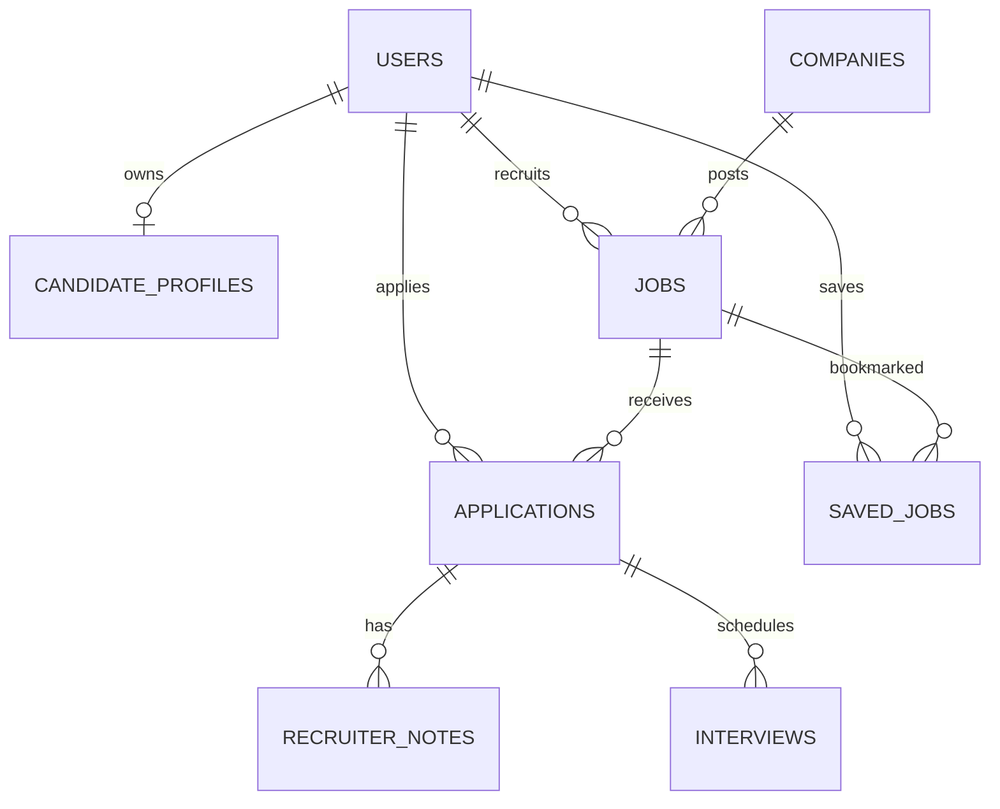

# Architecture and MongoDB design

TalentGraph uses a Vite React client and an Express/TypeScript API. MongoDB is the system of record; dashboard counts, match scores, and candidate/job listings are derived from stored records. API base: `/api/v1`.

Profiles embed bounded, user-owned skills, employment, education, projects, and resume metadata to load/edit one profile efficiently. Companies, jobs, users, applications, interviews, and notes are referenced because they have independent lifecycles, ownership rules, and queries. Application profile snapshots freeze only headline, skills, location, and experience as of submission. Resume storage is metadata-only in this initial implementation; uploads are not exposed.

## Index rationale

| Index | Query supported | Cost |
|---|---|---|
| `users.email` unique | Login and duplicate prevention | Maintains one key per account |
| `candidateprofiles.userId` unique | Own profile lookup | One key per profile |
| `skills.name, experienceYears` | Recruiter skill/experience filter | Multikey index increases profile write cost |
| Candidate profile text index | Candidate text discovery | Text index consumes storage and write work |
| `jobs.status, workMode, location.country, createdAt` | Published job list and filters | Compound key adds update cost |
| Job text index | Role and description discovery | Text index consumes storage and write work |
| `applications.jobId, candidateId` unique | Duplicate prevention | Enforces business invariant, one key per application |
| `applications.jobId, status, createdAt` | Recruiter pipeline inbox | Supports common scoped sort/filter |
| `applications.candidateId, createdAt` | Candidate application history | One key per application |
| `savedjobs.candidateId, jobId` unique | Saved list and duplicate prevention | One key per saved pair |
| `interviews.startAt, status` | Upcoming scheduling | One key per interview |
| `auditlogs.createdAt` | Recent administrative audit | One key per audit event |

Mongoose creates declared indexes at connection time. Production deployments should run controlled index rollout and inspect the actual query plan before adding indexes. Text search uses MongoDB text indexes and remains functional locally; Atlas Search is intentionally optional. Search term behavior is text-index token matching, while candidate skill matching currently uses a safely escaped case-insensitive regex.

## Matching

Deterministic score: required coverage × 0.45 + preferred coverage × 0.15 + experience × 0.20 + location/work-mode × 0.10 + title relevance × 0.10. Skill coverage is matched unique normalized skills divided by requested unique skills; an empty list scores 100 for that component. Experience is 100 inside the requested range, dropping 20 points per year outside, with a lower bound of zero; an open-ended maximum scores 100 once minimum experience is met and scales below the minimum. Location earns 100 for remote, same city, or same country, otherwise zero. Role relevance is 100 for a preferred-role/title substring match and 50 when no match exists. Scores are rounded to integers. Alias normalization is in `server/src/matching.ts`; extend that map as the vocabulary grows. The score is an explanation aid, never an automatic rejection.

Ranking fetches at most the requested page of profiles before scoring, and recommendations cap candidate jobs to 100. This bounds memory but is a practical baseline, not a globally exact top-K database ranking. A future database-side candidate prefilter should be benchmarked against the scoring function before broad ranking.

## Status flow

`applied → screening → shortlisted → interview → offer → hired`; screening, shortlisted, and interview may transition to rejected or withdrawn. Offer may transition to hired/rejected; terminal states cannot move. The status route checks the current state on the server and records actor/time/reason. Recruiters may access only their own job applications; administrators can audit all.

Recruiter job management uses the existing `Jobs` collection. `GET /api/v1/recruiter/jobs` returns a paginated owned-job list, MongoDB application counts, and status counts via aggregation. Create/edit validates the full job document and resolves the company under that recruiter's ownership; status transitions are restricted to draft → published/archive, published → closed/archive, and closed → published/archive. Publishing requires a future deadline. Candidate discovery continues to query published jobs only. Run `npm run test:integration -w server` for the isolated MongoDB test that covers draft creation, publish/discovery, edit, close, persisted list reload, and cross-recruiter ownership rejection.

## Security and limitations

Session JWTs are in HTTP-only, SameSite=Strict cookies, short-lived (8 hours), with configurable Secure flag and auth endpoint rate limits. Strict SameSite plus configured CORS is the CSRF baseline for same-site deployments; use HTTPS and same-site hostnames in production. There is no refresh token/session revocation, email verification flow, resume upload/storage provider, or complete admin moderation UI. No unrestricted diagnostics API is exposed. Diagnostics run only as a local developer command. Recruiter job management is implemented; interview scheduling, status notes, recruiter application review, analytics visualizations, moderation actions, and password settings remain API-only or incomplete.
